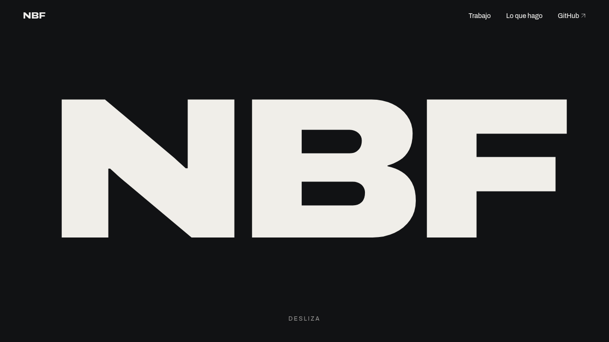
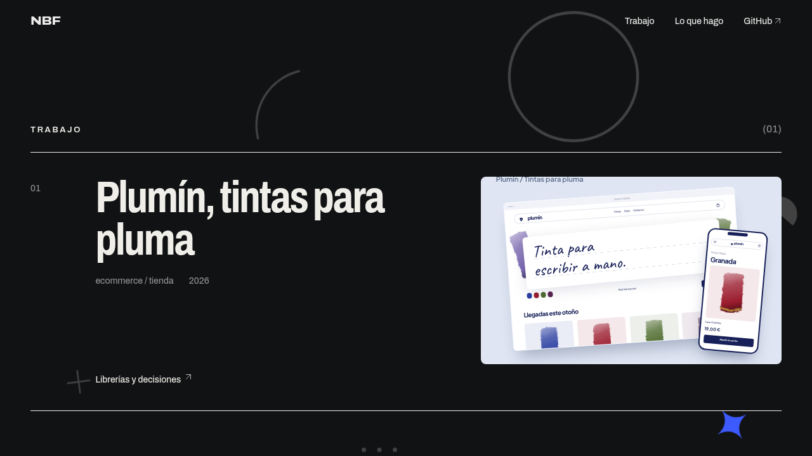
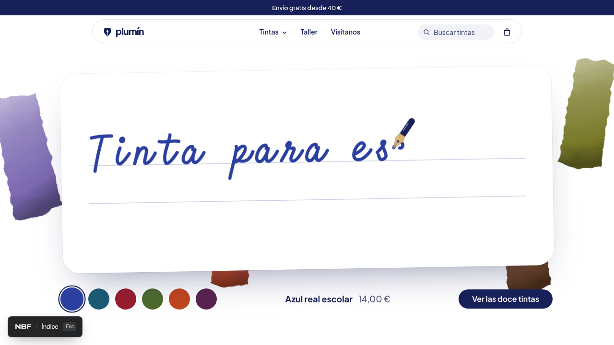
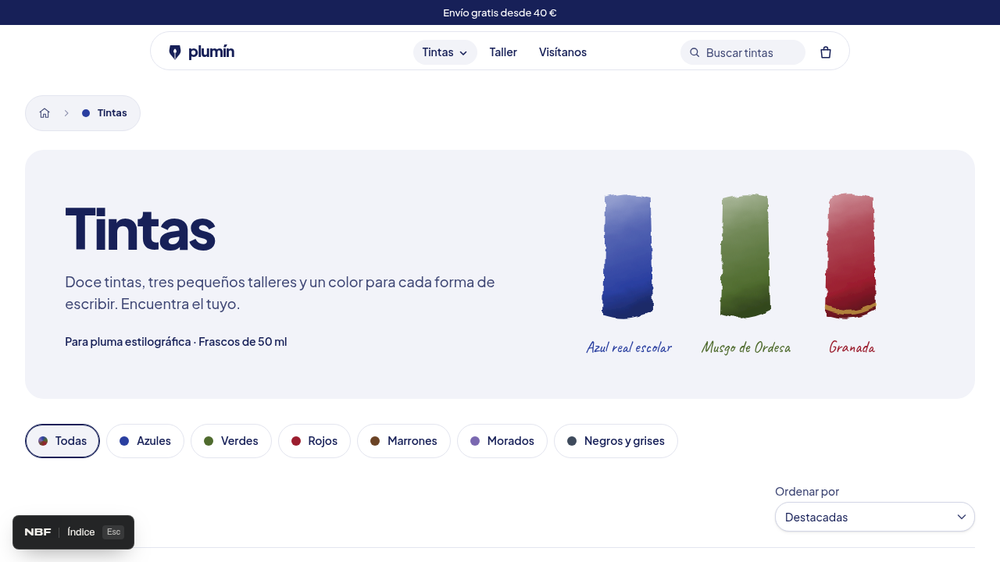
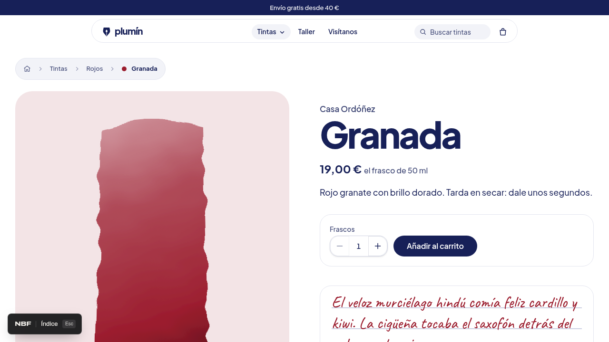

# uis

Portfolio de sitios web completos de demostración: tiendas, estudios, consultoras y otros negocios inventados. Cada proyecto tiene su propia identidad visual, navegación y páginas, con recorridos interactivos para explorar el sitio como una web independiente.

La portada (`/`) es **NBF**, el portfolio que reúne los proyectos: un monograma que se separa al hacer scroll, franjas de texto en movimiento, un recorrido horizontal por lo que hago, figuras SVG con parallax y una intro de carga. Las animaciones usan [Motion](https://motion.dev) y el scroll suave, [Lenis](https://lenis.darkroom.engineering); con movimiento reducido la página queda quieta.

**En línea:** https://nbfrodri.github.io/uis/


| Portada                                   | Trabajo                                                             |
| ----------------------------------------- | ------------------------------------------------------------------- |
|  |  |

| Web                                                   | Qué tiene                                                                                          |
| ----------------------------------------------------- | -------------------------------------------------------------------------------------------------- |
| [Plumín](https://nbfrodri.github.io/uis/f/001-plumin) | Tienda de tintas: hero escrito a mano, megamenú, buscador, catálogo, carrito, pago simulado y mapa |

### Plumín

Tienda ficticia de tintas para pluma estilográfica, con doce tintas de tres talleres. Incluye catálogo por familias de color, fichas de producto con muestras de escritura, caja personalizable de cinco muestras, carrito, proceso de compra simulado y página del taller. Las combinaciones de muestras se conservan en el carrito y en el resumen del pago; se pueden añadir varias cajas diferentes.

- [Explorar todas las tintas](https://nbfrodri.github.io/uis/f/001-plumin/tintas)
- [Ver la colección de rojos](https://nbfrodri.github.io/uis/f/001-plumin/tintas?familia=rojos)
- [Abrir la ficha de Granada](https://nbfrodri.github.io/uis/f/001-plumin/tintas/granada)
- [Librerías utilizadas y decisiones de diseño](src/fronts/001-plumin/README.md)


| Inicio                                             | Catálogo                                               | Ficha de producto                                  |
| -------------------------------------------------- | ------------------------------------------------------ | -------------------------------------------------- |
|  |  |  |

Los negocios y productos son inventados; el pago es una demostración y no se realizan compras reales.

## Arrancar

```sh
pnpm install
pnpm dev
```

## Añadir una web

```sh
pnpm new-front nombre-corto "Título visible"
```

Crea `src/fronts/NNN-nombre-corto/` a partir de `src/fronts/_template`:

- `meta.ts`: título, fecha, descripción y etiquetas que muestra la galería.
- `index.tsx`: la web. Importa aquí sus fuentes y CSS; nada se comparte con la galería salvo Tailwind y los estilos base de HeroUI.
- `README.md`: documentación de esa web, con sus librerías, su propósito y las decisiones de diseño. Se enlaza desde la presentación del proyecto en la portada de NBF.

Opcionalmente, añade `preview.tsx` con un componente por defecto para componer su portada visual en la galería. Es una vista decorativa y ligera: no debe montar otra aplicación, mapas ni controles interactivos. Si no existe, se muestra una portada tipográfica con el título del proyecto. Los estilos de estas vistas deben quedar acotados a su propia clase.

Cada web tiene sus propias páginas: define sus `<Routes>` con rutas relativas (la plantilla trae inicio, «sobre» y 404). Se abre en `/f/NNN-nombre-corto` y sus páginas cuelgan de ahí (`/f/NNN-nombre-corto/sobre`).

Usa las librerías que necesite (`pnpm add …`): HeroUI, Base UI, Motion, MapLibre… Solo se cargan al abrir esa web. Ojo: `font-sans` cae en la fuente del sistema; carga siempre una fuente propia (p. ej. `@fontsource-variable/...`).

`Esc` o el botón «Índice» vuelven a la galería. Las carpetas que empiezan por `_` no se listan.

## Comprobaciones

```sh
pnpm test     # Vitest
pnpm check    # Biome (lint + formato)
pnpm build    # tsc + build de producción
```

## Publicación

Las pull requests a `main` pasan el lint, los tests y la build sin publicar. Cada push a `main` repite las comprobaciones y publica en GitHub Pages (`.github/workflows/deploy.yml`), bajo `/uis/`. La publicación manual también queda limitada a `main`.

## Capturas y GIFs

Las imágenes de `docs/media/` se generan con un script. Con el servidor de desarrollo en marcha (`pnpm dev --port 5288`), ejecuta `node scripts/capture-demo.mjs`; necesita `chromium` y `ffmpeg`.
